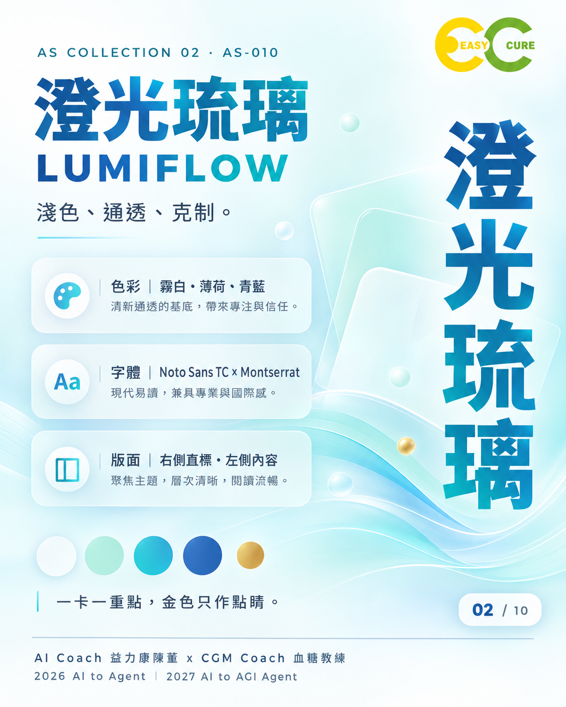
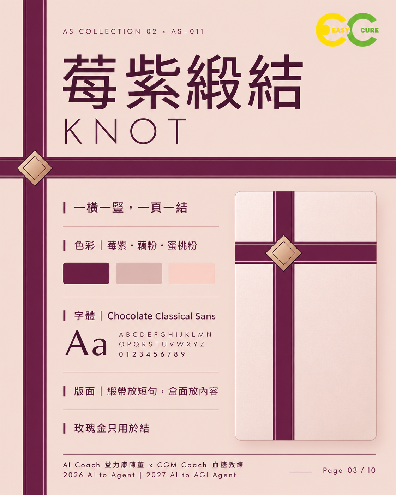
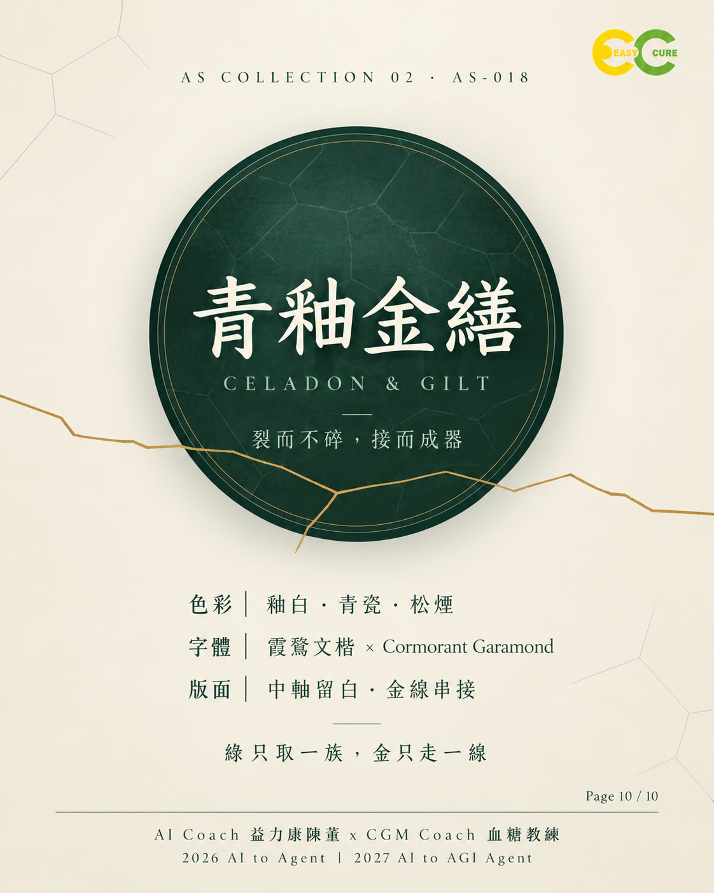

# AS｜Agent Style Systems

**讓Agent依據可追溯規格延續品牌風格。** 收錄 Collection 01、02 共 18 套設計系統，持續擴充。

## 兩批設計系統與完整介紹

| AS Collection 01｜第一批 | AS Collection 02｜第二批 |
|---|---|
|  |  |
| **AS-001～AS-009**：從品牌視覺建立可追溯設計規則。 | **AS-010～AS-018**：延伸九種視覺語言與執行規格。 |
| [第一批完整說明](collections/01/SOCIAL-POST.md) · [第一批風格目錄](collections/01/README.md) | [第二批完整說明](collections/02/SOCIAL-POST.md) · [第二批風格目錄](collections/02/README.md) |

[風格展示頁](index.html) · [快速開始](docs/QUICKSTART.md) · [批次規則](docs/COLLECTION-POLICY.md) · [驗證紀錄](docs/VALIDATION.md)

## 為什麼建立AS

讓「高級、科技、親切」這類感受轉成色彩、字體、構圖、元件與限制，減少系列作品風格漂移。這是規格知識庫與提示詞工具包，不是已驗證所有平台的自動生成程式。

## Collection入口

| 系列 | 風格編號 | 狀態 |
|---|---|---|
| [AS Collection 01](collections/01/README.md) | AS-001～AS-009 | 來源規格v0.1；含OPEN問題 |
| [AS Collection 02](collections/02/README.md) | AS-010～AS-018 | 來源規格 v0.1；25 項 OPEN |

所有批次都收錄在本Repo；Collection 02 另有[獨立 Repo](https://github.com/draiagent/ai-to-agent-style-systems-02)（v0.1.0，規格與來源圖相同，文件為較早的章節結構）。修訂保留原編號，規則詳見[Collection政策](docs/COLLECTION-POLICY.md)。

## 18 套風格總覽

| 風格 | 預覽 | 規格與指令 |
|---|---|---|
| **AS-001 朱漆直書** Vermilion Script |  | [規格](collections/01/styles/AS-001/SPEC.md) · [指令](collections/01/styles/AS-001/PROMPT.md) |
| **AS-002 青金絲緞** Satin Teal & Gold |  | [規格](collections/01/styles/AS-002/SPEC.md) · [指令](collections/01/styles/AS-002/PROMPT.md) |
| **AS-003 深海時刻** Abyss Hour |  | [規格](collections/01/styles/AS-003/SPEC.md) · [指令](collections/01/styles/AS-003/PROMPT.md) |
| **AS-004 益生寵愛・莓果貼紙** Berry Sticker |  | [規格](collections/01/styles/AS-004/SPEC.md) · [指令](collections/01/styles/AS-004/PROMPT.md) |
| **AS-005 EASY CURE・黃綠雙環** Twin Ring System |  | [規格](collections/01/styles/AS-005/SPEC.md) · [指令](collections/01/styles/AS-005/PROMPT.md) |
| **AS-006 翡翠禮匣** Emerald Coffret |  | [規格](collections/01/styles/AS-006/SPEC.md) · [指令](collections/01/styles/AS-006/PROMPT.md) |
| **AS-007 墨白桐花** Ink & Blossom |  | [規格](collections/01/styles/AS-007/SPEC.md) · [指令](collections/01/styles/AS-007/PROMPT.md) |
| **AS-008 潮汐實證** Tidal Proof |  | [規格](collections/01/styles/AS-008/SPEC.md) · [指令](collections/01/styles/AS-008/PROMPT.md) |
| **AS-009 橙鞍工坊** Orange Atelier |  | [規格](collections/01/styles/AS-009/SPEC.md) · [指令](collections/01/styles/AS-009/PROMPT.md) |

| **AS-010 澄光琉璃** LUMIFLOW |  | [規格](collections/02/styles/AS-010/SPEC.md) · [指令](collections/02/styles/AS-010/PROMPT.md) |
| **AS-011 莓紫緞結** KNOT |  | [規格](collections/02/styles/AS-011/SPEC.md) · [指令](collections/02/styles/AS-011/PROMPT.md) |
| **AS-012 焦茶裁字** UMBER |  | [規格](collections/02/styles/AS-012/SPEC.md) · [指令](collections/02/styles/AS-012/PROMPT.md) |
| **AS-013 棗拱金珠** ALCOVE |  | [規格](collections/02/styles/AS-013/SPEC.md) · [指令](collections/02/styles/AS-013/PROMPT.md) |
| **AS-014 青盒赭扣** CLASP |  | [規格](collections/02/styles/AS-014/SPEC.md) · [指令](collections/02/styles/AS-014/PROMPT.md) |
| **AS-015 紫金對開** FOLIO |  | [規格](collections/02/styles/AS-015/SPEC.md) · [指令](collections/02/styles/AS-015/PROMPT.md) |
| **AS-016 絳青疊瓣** VESICA |  | [規格](collections/02/styles/AS-016/SPEC.md) · [指令](collections/02/styles/AS-016/PROMPT.md) |
| **AS-017 紫銅經緯** LOOM |  | [規格](collections/02/styles/AS-017/SPEC.md) · [指令](collections/02/styles/AS-017/PROMPT.md) |
| **AS-018 青釉金繕** CELADON & GILT |  | [規格](collections/02/styles/AS-018/SPEC.md) · [指令](collections/02/styles/AS-018/PROMPT.md) |

## 怎麼用

看風格 → 選一套 → 複製[共用指令](prompts/agent-task.txt)與該套附加指令 → 提供內容及素材 → 先做樣張 → 核對後展開系列。

**輸入：**內容重點、受眾、媒介尺寸、Logo與圖片、參考風格、署名、可編輯需求。
**輸出：**指定成品、採用規則、適配說明、未決事項與驗收紀錄。

閱讀無需安裝；生成時由使用者提供相應Agent與工具。完整填寫例見[AS-002課程圖卡](examples/as-002-course-card.md)。

## 規格與驗證邊界

E為原圖明訂，O為視覺觀察，P為適配提案，Q為未決問題。第一批 88 條規則、第二批 63 個逐頁規則群，共 126 張來源 PNG 可追溯；兩批分別保留 13 與 25 項未決問題。介紹圖卡是生成示例，不作精確字型或色彩面積的驗證憑據。
圖片、簡報、文件／文字、互動網頁、動畫、影片共六媒介已有[適配提案](docs/MEDIA-ADAPTATION.md)，尚未全面生成實測。適合設計溝通、教材及Agent任務；不適用直接宣稱正式品牌授權、精確工程Token或醫療成果。

## 第二批入口

[Collection 02](collections/02/README.md) · [規格](collections/02/SPECIFICATION.md) · [Agent 指令](collections/02/AGENT-INSTRUCTIONS.md) · [社群文章](collections/02/SOCIAL-POST.md) · [未決事項](collections/02/OPEN-QUESTIONS.md)

## 第一批檔案入口

- [完整文字規格](collections/01/SPECIFICATION.md)、[未決登錄](collections/01/OPEN-QUESTIONS.md)
- [10張圖卡](collections/01/cards/README.md)、[來源PNG雜湊清單](collections/01/sources/manifest.json)
- [社群文章](docs/SOCIAL-POST.md)、[驗收母版](docs/VALIDATION-TEMPLATE.md)
- [來源與權利聲明](docs/ATTRIBUTION.md)、[貢獻方式](CONTRIBUTING.md)
- [版本紀錄](CHANGELOG.md)、[發布準備](docs/PUBLISHING.md)

## 版本與後續

Repo 版本 **0.2.2**，日期 **2026-10-12**；兩批来源規格均為 **v0.1**。下一個風格編號 **AS-019**。
兩批使用相同文件介面；第一批完整介紹已恢復於首頁並保留原始路徑。原始規格、來源圖片與圖卡均保留。後續依實際需求處理 OPEN 問題與驗證各媒材。

## 授權與致謝

**本 repo 採保留所有權利（All rights reserved），見[LICENSE](LICENSE)，不是開源授權；法律權利人為 AI Coach 益力康陳董。** Logo、人物、商標與第三方字型另行處理。
展示組織方式參考[Vincentwei1021/mg-styles-15](https://github.com/Vincentwei1021/mg-styles-15)，未複製其程式與媒體素材。

AI Coach 益力康陳董 x CGM Coach 血糖教練 | 2026 AI to Agent | 2027 AI to AGI Agent
